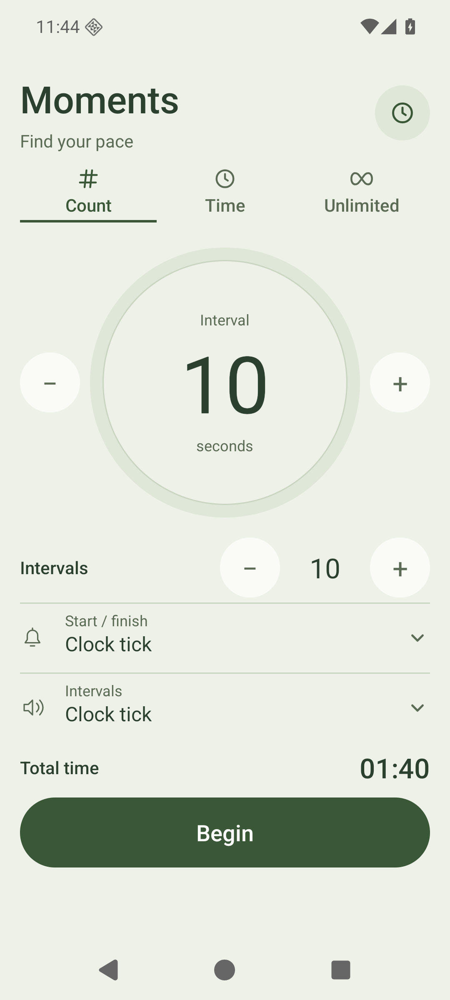
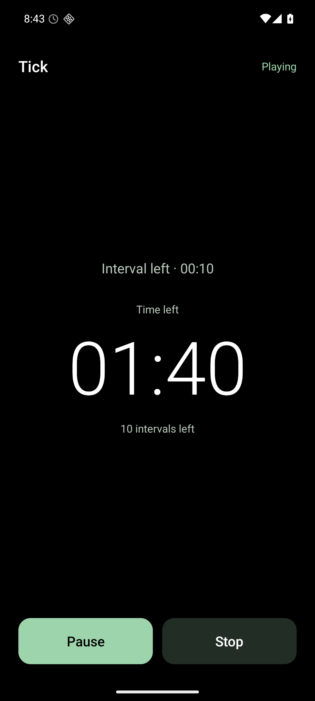

# Moments

An offline Android meditation interval timer. Kotlin, native Android views, one app module, and no network permission. Android 8 or newer. Application ID `net.namekdev.moments`.

## Screenshots

| Settings | Timer |
| --- | --- |
|  |  |

## Build a release APK

Use JDK 21 and an Android SDK with platform 36 and build tools 35.0.0 installed. The project pins Gradle 8.13, Android Gradle Plugin 8.13.2, and Kotlin 2.3.21. Compile and target SDK are 36; minimum SDK is 26. Java and Kotlin bytecode target 17.

On macOS:

```sh
export JAVA_HOME="$(/usr/libexec/java_home -v 21)"
export ANDROID_HOME=/path/to/android-sdk
./gradlew testReleaseUnitTest lintRelease assembleRelease
mkdir -p dist
cp app/build/outputs/apk/release/app-release-unsigned.apk dist/moments-release.apk
```

Alternatively, put `sdk.dir=/path/to/android-sdk` in a local, untracked `local.properties`. Android Studio can create it. The first build downloads dependencies; the app itself is entirely offline. Use `--offline` for subsequent builds if all dependencies are cached.

The release APK is `dist/moments-release.apk`. It is unsigned; Android requires a signature before installation.

To build an Android App Bundle, run `./gradlew bundleRelease` with the same JDK and SDK. The output is `app/build/outputs/bundle/release/app-release.aab`. This repository does not configure release signing, so the bundle also needs signing before uploading to Play Console.

The application ID is now `net.namekdev.moments`. Android treats this as a separate app from earlier builds using `net.namekdev.ticker`; their saved settings do not transfer automatically. Both apps can be installed at the same time.

## Use

The defaults are a 10-second interval, Count mode with 10 intervals, and Clock tick. Choose **Count**, **Time**, or **Unlimited** at the top. Count means full intervals: an interval of 10 seconds and a count of 3 lasts 30 seconds. Time uses minutes and seconds, initially 10 minutes, and can end between intervals. For example, a 25-second limit with a 10-second interval plays at 0, 10, 20, and 25 seconds.

The compact settings screen groups Count, Time, and Unlimited into a segmented selector with distinct icons and places the interval and selected limit side by side. Inputs and buttons retain 48 dp touch targets. Start and the session duration preview sit directly below the controls, so ordinary portrait and landscape layouts need no scrolling. Larger accessibility fonts can stack the controls and scroll as needed. The preview updates as you edit, shows "No time limit" in Unlimited, and asks you to check invalid settings. Interval and count accept whole numbers from 1 to 2147483647. Time limit accepts whole minutes and 0–59 seconds, with a total from 1 to 2147483647 seconds. Invalid edits show an error and never overwrite saved valid values. Every valid setting saves automatically in SharedPreferences: interval, count, time limit, selected mode, Unlimited, and sound. They survive closing, force-stop, and reboot, even if you never press Start. Unlimited hides the limit inputs while retaining their values. Select either finite mode to show its saved limit again.

The interface uses native Android views with a shared green palette, outlined inputs, and rounded controls in light and dark themes. Pause/Resume is the primary action during playback. Wider windows keep the controls in a centered column. The launcher uses an [adaptive icon with a monochrome layer](https://developer.android.com/develop/ui/compose/system/icon_design_adaptive) for themed icons. No UI library or runtime dependency is required.

The Sound dropdown offers **No sound** and real recordings of Clock tick, Electric wall clock, Gong, Singing bowl, and Soft bell. No sound runs the timer and visual cues without loading or playing audio, and selecting it stops any preview. Electric wall clock is a short tick from a quartz wall-clock recording. Selecting a recording previews it, including selecting the same sound again. The selection saves automatically and is locked during playback. Changing sounds, starting a session, rotating, or leaving the screen cancels the preview. Restoring settings never starts a preview. The recordings are bundled offline and normalized for stronger playback; [sources, creators, and public-domain licenses](audio-sources/CREDITS.md) are included. Media volume controls playback volume; the app does not change the device volume.

Start opens a playback screen with a large centered timer, Pause, and Stop. A smaller interval countdown appears above the main timer. It resets at each boundary, freezes while paused, and shortens to the remaining time if a time limit ends before the next full interval. The background is pure black between cues, including behind the system bars, in both light and dark themes and while paused. Each completed interval flashes muted red for 300 ms; the final boundary flashes muted green. Both colors use brightness contrast against black so the cues remain visible in grayscale. There is no flash at Start, and missed flashes are not replayed when reopening the app. Flashes do not wake a locked screen.

The main timer grows up to 96 sp and scales down to fit longer durations or narrow screens. Settings follow the system theme. Finite sessions count down to zero; Interval count mode also shows a small intervals-left label. Unlimited shows elapsed time counting up and continues until stopped. A recorded sound starts as soon as its bundled sample loads; No sound starts immediately. Finite sessions hold 00:00 while the ending sound rings out, or for the 300 ms final flash in No sound mode, then return to settings. The settings screen shows a playback error only if something goes wrong.

Pause freezes both timers, interval progress, and any sound still ringing. Resume continues the same session from that point, preserving the remaining fraction of the interval without playing an extra starting sound. Pausing the final sound also pauses completion until resumed. Pause becomes available once playback starts. Paused sessions survive rotation, reopening, and screen lock; settings stay locked until the session ends.

Stop inside the app asks for confirmation. Choose Keep ticking, or Keep paused during a pause, to keep the session. Choose Stop to end it and return to configuration. Another Start resets both the timer and counter. Configuration is hidden during playback. The timer survives rotation, reopening, and screen lock because its monotonic start time belongs to the service.

Playback uses media volume and never requests audio focus, so it can mix with music or podcasts. It continues when you rotate, leave the app, dismiss its recent task, or lock the screen. Reopen Moments to see the active session. Process termination, force-stop, or reboot ends playback. Settings survive those events.

Android 13 and newer ask for notification permission on the first valid Start. Playback starts regardless of the answer. The silent ongoing notification has Pause/Resume and Stop actions. Stop in the notification ends the session immediately. If notifications are denied, these controls remain available inside the app.

## Timing and lifecycle

The displayed digits and next refresh use the same elapsed-time sample. Refreshes use absolute second boundaries; if drawing runs late, the display catches up immediately instead of holding an old digit until the following second. Android can still delay drawing while the main thread is busy.

Interval sounds and flashes use the same timer callback. The playback screen updates its flash directly on each cue without rebuilding the settings UI. Each recorded sample has a strong attack within its first 20 ms; the singing bowl's quiet 175 ms intro is trimmed. Display refresh and device audio output latency can still produce a physical offset, especially with Bluetooth, so this is not a guarantee of hardware-level synchronization.

`TickService` owns the SoundPool, foreground notification, partial wake lock, and session state. The activity binds to it for state updates. The service is non-exported, declares `mediaPlayback`, and returns `START_NOT_STICKY`. There is no boot receiver or persisted playback session.

The timer uses `SystemClock.elapsedRealtime()`. Interval boundaries and the finite end time stay anchored to the session start, shifted forward by the duration of each pause. A late callback plays at most one sound and schedules one future boundary; missed slots are skipped. Completed and remaining interval counts follow elapsed time, including skipped slots. A callback arriving at or after the end plays the final sound once and finishes without extending the deadline or showing negative time. A time limit that falls on an interval boundary produces one ending cue. Long sound tails may overlap at short intervals without delaying the next boundary; SoundPool allows four simultaneous streams.

Pause cancels scheduled callbacks, pauses SoundPool streams with `autoPause()`, and releases the partial wake lock. The foreground service and loaded sound remain available for Resume, which reacquires the lock, uses `autoResume()`, and schedules the remaining delay. Duplicate Pause, Resume, and Start commands do not reset the session. Stale callbacks cannot play after Pause or Stop.

Recreate the edited mono 44.1 kHz PCM WAVs with `python3 scripts/prepare_sounds.py` and FFmpeg. Source recordings are in `audio-sources/`; ordinary builds need only the checked-in WAVs. Clock tick is 300 ms, Electric wall clock is 150 ms, Gong and Singing bowl are 3 seconds, and Soft bell is 2 seconds. Samples have smooth tail fades. Clock tick is a single pendulum tick from an original 24-bit grandfather-clock recording. Electric wall clock uses one tick from a quartz clock's recording. Neither clock sample receives dynamic compression, equalization, or pitch changes. The gong uses a soft studio recording, peaking at 45% of full scale to leave about 7 dB of headroom, without compression. The other sounds peak at 94%; only the bell receives light dynamic compression. Every decoded sample stays below SoundPool's one-megabyte limit. Actual loudness also depends on media volume and the speaker.

SoundPool does not provide an end-of-playback callback. After the final boundary, the app waits for the selected sample's duration plus a 200 ms output drain margin before releasing audio. Previews use the same completion margin. This is timer-based completion, not a hardware audio timestamp. Android scheduling and output devices can add latency.

Stop, finite completion, load timeout, playback failure, and service destruction cancel callbacks, invalidate old callbacks, release SoundPool and the wake lock, and remove the foreground notification. An old SoundPool load callback cannot restart a stopped session. Duplicate Start commands are ignored.

## Test on an emulator

Start an Android 16 emulator, then select its serial explicitly:

```sh
adb devices
ANDROID_SERIAL=emulator-5580 ./gradlew connectedDebugAndroidTest
python3 scripts/emulator_smoke.py --serial emulator-5580
```

The Python smoke test requires Python 3 and ADB on `PATH`, plus the app and test APKs built by `connectedDebugAndroidTest`. It refuses physical-device serials. It clears Moments' data on that emulator, exercises the real notification permission dialog, Pause/Resume and Stop controls in the app and notification shade, and checks both countdown modes. It checks screen-off playback and paused state, wake lock release and reacquisition, reopening, process termination, and reboot. Settings survive while process termination or reboot ends the session. A native instrumentation probe in the test APK reads the current accessibility tree without waiting for the continuously updating timer to become idle. This probe is absent from the delivered app APK.

Unit tests cover immediate playback, full interval counts and the ending sound, time limits on and between boundaries, limits shorter than an interval, unlimited mode, cancellation before the end and during its tail, stale callbacks, timing drift, delayed callbacks past the deadline, each sound's completion and one-second cadence, playback failure, numeric bounds, countdown overflow and formatting, unknown sound fallback, and every WAV's duration, decoded size, and signal level. Instrumentation covers count/time validation and persistence, mutually exclusive modes and hidden limit inputs in Unlimited, countdown direction and zero during the final sound, intervals-left visibility, native dropdown previews and same-item replay, rapid preview replacement while loading, preview cancellation on Start/rotation/reopening, sound restoration, playback and cleanup for every sound, rotation and reopening during countdown, elapsed time in Unlimited, timer reset, confirming and canceling Stop, confirmation restoration, completion during confirmation, rapid Start/Stop, duplicate starts, queued restarts after all clients unbind, stopping while SoundPool loads, screen-off playback, notification Stop, and resource cleanup.

Pause tests cover remaining interval fractions, both finite limits, repeated pauses in Unlimited, paused final sounds, stale and duplicate commands, late callbacks after resuming, Stop while paused, rotation, reopening, screen lock, notification controls, and wake lock cleanup.

Silent-mode tests check preview cancellation, no SoundPool allocation, interval countdowns, red and green flashes in both finite modes, and pausing/reopening in Unlimited. The ADB smoke test also checks every saved setting after force-stop and reboot, including No sound and the inactive finite limits.

Reports are written to:

- `app/build/reports/tests/testReleaseUnitTest/index.html`
- `app/build/reports/androidTests/connected/debug/index.html`
- `app/build/reports/lint-results-release.html`

Inspect a running session with:

```sh
adb -s emulator-5580 shell dumpsys activity service net.namekdev.moments/.TickService
adb -s emulator-5580 shell dumpsys power
```

## Install on an Android device

After signing the release APK, enable USB debugging, connect the device, accept its debugging prompt, and use its serial from `adb devices`:

```sh
adb -s DEVICE_SERIAL install -r dist/moments-release.apk
adb -s DEVICE_SERIAL shell am start -n net.namekdev.moments/.MainActivity
```

Testing for this delivery uses only the emulator.

## Android references

- [AGP 8.13 compatibility and Kotlin 2.3 support](https://developer.android.com/build/releases/agp-8-13-0-release-notes)
- [Media playback foreground service requirements](https://developer.android.com/develop/background-work/services/fgs/service-types#media)
- [Notification permission behavior](https://developer.android.com/develop/ui/views/notifications/notification-permission)
- [SoundPool loading, playback and release](https://developer.android.com/reference/android/media/SoundPool)
